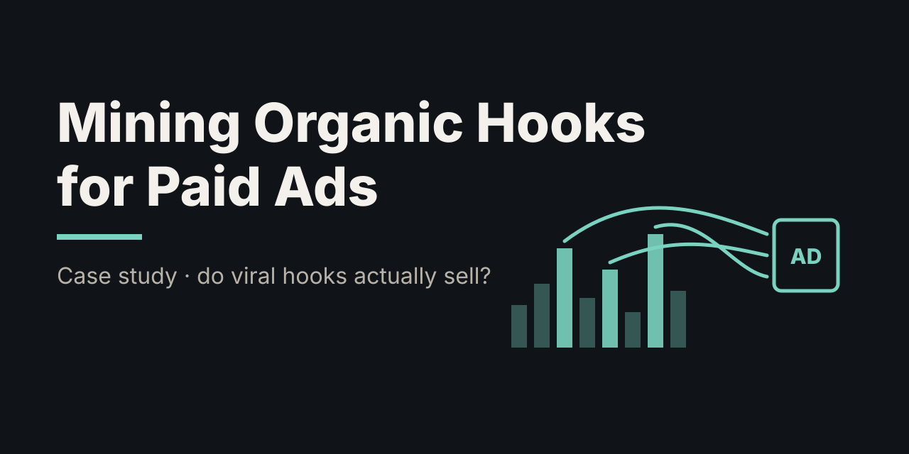
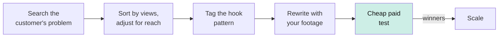
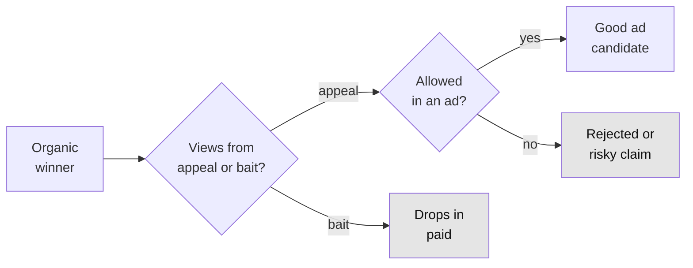

# Mining Organic Hooks for Paid Ads

> **TL;DR:** The reel's tip: to write ad hooks, search TikTok for your customer's *problem* (not your product), study the openings of the most-viewed organic videos, and use those patterns in paid ads that look like regular posts. It's a sound way to *generate* hook ideas, and the research on native-looking ads backs it up. But views and sales aren't the same thing. In bait-heavy niches like health, the most-viewed hooks can convert worse than random ones, and many can't legally run as ads. Rank by views relative to the creator's following, filter for ad policy, and let a cheap paid test pick the winners.

**Spark:** [Instagram reel by @markbuildsbrands](https://www.instagram.com/reel/DeM1R-loXgk/) · **Angle:** case study · **Date:** 2026-10-13

## The claim vs. reality

**The reel's pitch, in short:** whatever you sell, work out its niche and the problem it solves. Search TikTok for the problem (his example: knee pain), sort out the most-viewed videos, and study their hooks. He notes that organic and paid differ (paid needs conversions, organic just needs views) but says the opening clips that win organic attention carry over. Ads built that way look like ordinary posts in the feed, and he says that approach has made him good money. On screen, he shows an Ads Manager table with returns on ad spend of roughly 2.4–9.4× (dated Oct 2021–Feb 2022). It isn't tied to a specific hook, so it's an anecdote, not evidence for the method.

**What the comments said:** a performance marketer said researching organic content before launching a brand's first campaign raised their win rate. Other comments asked how it applies to static ads and to a meal-prep business, and one pointed out that the comments under viral posts are free market research. That last point is supported by the research below.

**What the research says:**

| Claim | Evidence | Verdict |
|---|---|---|
| Hooks are where ads win or lose | Up to 47% of video campaign value in the first 3 seconds [1]; creative ~47% of sales lift [2] | ✅ Directionally right |
| Search the problem, study top organic hooks | TikTok sells the same idea as a tool (Creative Center, Keyword Insights) [3] | ✅ Good research habit |
| Ads that look like regular posts work better | Few people recognise native-style ads; recognition lowers evaluations [4] | ✅ Supported |
| Organic winners carry over to paid | Persuasiveness fell ~10% per million views in Tucker's study [5]; top picks are partly luck [6] | ⚠️ Partly. Depends on *why* the post got views |
| Copy what works | Many top health hooks break Meta policy or FTC claim rules [7][8]; copy patterns, not videos [9] | ⚠️ Filter first |

The creator is upfront that organic and paid have different goals. The gap the reel skips is *how* to tell which organic winners will also sell, and which ones you can't run as ads at all.

## How it works

The tactic splits the job between two channels. Organic content is a huge, free experiment in what grabs attention: millions of people vote with their thumbs on thousands of hooks. Paid ads then take the winning hooks and put them in front of people who can buy.



There are two filters on the way, and the reel only shows the first:



## Deep dive

### 1. Why hooks matter this much

The first seconds of a feed video carry a large share of its effect. A 2016 Facebook-commissioned Nielsen analysis found that up to 47% of a video campaign's value came in the first three seconds, and up to 74% in the first ten [1]. That's a platform studying its own product, so treat it as directional. Across about 500 campaigns, the NCSolutions/Nielsen "Five Keys" study attributed about 47% of the sales lift from advertising to the creative, more than reach (22%) or targeting (9%) [2]. If creative is the biggest lever and the hook is the biggest part of the creative, then finding better hooks is high-value work.

### 2. Organic search is free creative research, and the platforms agree

The method is to type your customer's problem into TikTok search, look at the most-viewed results, and study their openings. That's a manual version of something TikTok sells as a product. Its Creative Center has a Top Ads library and a Keyword Insights tool that shows phrases from high-performing ads, with how often each is used and the average click-through rate [3]. TikTok's own long-running advice to advertisers is to make ads that look and feel like native posts.

There's a sound reason this works. Ads that look like organic content are harder to recognise as ads. In Wojdynski and Evans's experiments, only 7% of readers identified a sponsored article as advertising in one study, and 17% in the other. Once people *did* recognise it, they rated the content and the brand lower [4]. So a hook that reads like an organic post gets past the "skip, it's an ad" reflex.

### 3. Views and persuasion are different things

This is the catch. The creator acknowledges that organic optimises for views and paid for conversions, but treats winning hooks as transferable. The best evidence says that's only partly true.

- **Catherine Tucker (MIT)** measured the reach of about 400 video ads and ran randomized persuasion tests with roughly 24,000 people. On average, persuasiveness fell about **10% for every million views** an ad achieved. Views earned by being outrageous didn't translate into wanting the product. The exceptions were ads that drew lots of comments, especially comments mentioning the product, and that earned their views through humour rather than shock [5].
- **Reach inflates raw views.** A post with 4 million views from a 600,000-follower account is less impressive than 1 million from a 50,000-follower account. Sorting by raw views partly sorts by creator size, which tells you nothing about the hook.
- **Luck inflates the winners.** When you pick the top few out of hundreds, part of why they're on top is chance (timing, the algorithm). That part doesn't repeat. Airbnb's experimentation team documented the same "winner's curse" in A/B tests: effects of the experiments that won are systematically overestimated [6].

### 4. Organic creators can say things advertisers can't

In a health niche like knee pain, many of the most-viewed organic hooks would get an ad rejected or create legal risk:

- **Meta's personal-attributes policy** bars ads that assert or imply knowledge of a viewer's health condition. Direct "your knee hurts?" phrasing in second person is a common reason for rejection [7].
- **FTC health claims.** The FTC's 2022 Health Products Compliance Guidance says health benefit claims need competent and reliable scientific evidence, usually randomized controlled trials. Testimonials and anecdotes don't count, and hedges like "may help" don't fix a weak claim [8]. A home-remedy hook that goes viral organically becomes a claim you have to back up once you pay to promote it.
- **Copy the pattern, not the post.** Short phrases and ideas aren't protected by copyright [9], so the hook *pattern* ("Pain right here? Here's what it means") is fair game. The creator's actual video, voice and footage are not.

### 5. What the code shows

**`hook_miner.py`** ranks a hand-collected set of posts (synthetic sample data for "knee pain") by how far each beat its own audience. Then it tags the hook pattern and flags policy risks:

```
 #  score views/fol  views  hook
 1   1.36     12.7x   1.4M  Old remedy for achy knees grandma swore by  [health claim, bait]
 2   1.33     15.3x   2.3M  All you need is a lime and a spoon for achy knees  [health claim]
 3   1.18     36.7x   0.3M  I fixed my knee pain without surgery  [health claim]
 4   1.17     32.2x   2.9M  Doctors hate this knee trick  [bait]
 5   1.00     31.7x   0.4M  My husband had two knee replacements. Here is what helped  [health claim]
 ...
Only 5/10 of the most-VIEWED posts are in the top 10 by outlier score.
```

In this sample, **every one of the top five organic hooks is one you probably couldn't run as an ad**. Remedies, testimonials and bait do well organically for exactly the reasons they're risky in paid. The shortlist that survives the filters is less exciting: a body-spot callout question, a "2-minute routine," and a sensation hook. Authority hooks ("physio explains...") score low here partly because those accounts have big followings, so their views look less surprising.

**`winners_curse.py`** simulates the whole process. Each hook has hidden *appeal* (helps sales) and *bait* (wins views, hurts persuasion, per Tucker). Pick 5 of 300 posts:

```
Scenario: no bait (views come only from real appeal)
  Random 5 hooks               CVR 1.07%      +0% vs random
  Top 5 by views (the reel)    CVR 1.66%     +55% vs random
  Top 5 by views/followers     CVR 1.90%     +79% vs random
  Shortlist 20, test, keep 5   CVR 2.16%    +103% vs random

Scenario: some bait (typical feed)
  Top 5 by views (the reel)    CVR 1.44%     +34% vs random
  Top 5 by views/followers     CVR 1.57%     +46% vs random
  Shortlist 20, test, keep 5   CVR 2.04%     +90% vs random

Scenario: heavy bait (health/outrage niches)
  Top 5 by views (the reel)    CVR 0.98%     -12% vs random
  Top 5 by views/followers     CVR 0.97%     -13% vs random
  Shortlist 20, test, keep 5   CVR 1.59%     +43% vs random

Winner's curse (no bait, reach removed): the top 5 hooks' organic edge is about 50% real appeal and 50% luck.
```

How to read it:
- **The reel's method works in most feeds.** Copying the top organic hooks beat random picks by 34–55%.
- **Adjusting for creator size is a free improvement**: +79% instead of +55% in the clean case.
- **In bait-heavy niches it can backfire.** When views come mostly from provocation, the most-viewed hooks convert *worse* than random ones. Health is one of those niches.
- **A cheap test of a 20-hook shortlist wins in every scenario.** Organic data is a good way to generate candidates, but it's a poor judge of which ones sell.

## Apply it

```bash
python3 code/hook_miner.py
python3 code/winners_curse.py
```

To use it on your own niche:

1. **Search the problem, not the product.** Type what your customer would search when they have the problem ("knee pain," "dog pulls on leash," "meal prep for the week"). Use TikTok search and Instagram search.
2. **Log 20–50 posts by hand** into a CSV with views, likes, comments, shares, follower count and the hook (first line or on-screen text). Run `hook_miner.py my_posts.csv`.
3. **Rank by views ÷ followers, not raw views.** Small accounts with huge posts are the strongest signal that the hook did the work.
4. **Read the comments on the winners.** Comments that mention the problem or ask "where do I get this?" signal persuasion. Arguments and jokes signal bait (Tucker's comment finding).
5. **Rewrite, don't repost.** Keep the pattern, use your own words and footage, and drop anything that implies the viewer's condition or makes a claim you can't back up.
6. **Test before you scale.** Run 10–20 hooks on the same body and offer with a small budget each. Judge them on cost per purchase, not on thumb-stop rate alone, then put the money behind the top few.

## Assumptions

| Parameter | Value | Anchored to |
|---|---|---|
| Sample posts (`sample_posts.csv`) | 24 knee-pain hooks | Synthetic, written for this repo; not real TikTok data |
| Hook score weights | outlier 1.0, share rate 0.5, comment rate 0.25 | Illustrative. Comments weighted lightly because they can mean outrage [5] |
| Posts scanned / hooks picked | 300 / 5 | Illustrative guess |
| Reach SD / luck SD | 1.2 / 1.0 | Illustrative. Creator size varies more than algorithm luck |
| Bait penalty on paid persuasion | 0.6 × bait | Direction from Tucker's ~10% loss per million views [5]; size is a guess |
| Paid test noise | 0.5 SD | Illustrative small-budget test |
| Base conversion rate | 1.0% | Illustrative |
| Bait levels | 0 / 0.7 / 1.5 | Illustrative scenarios |

## Takeaways

- Organic search for your customer's problem is a free, large-scale hook experiment. Use it to generate candidates.
- Rank by views relative to the creator's following, not raw views, and read the comments to tell appeal from bait.
- Views and sales are different: viral reach can come at the cost of persuasion, especially in health and outrage niches.
- Many of the best organic hooks can't legally or policy-wise run as ads. Filter for personal-attribute phrasing and unsupported claims.
- Copy the pattern, not the post, then let a cheap paid test pick the winners.

## Open questions

- How strong is the organic-to-paid correlation in practice? No public dataset pairs organic views with paid results for the same hooks.
- Does Tucker's reach-versus-persuasion trade-off hold for short-form vertical video in 2026? Her data was from earlier video ads.
- How quickly does a copied hook pattern wear out once many advertisers use it?
- Do TikTok's Keyword Insights CTR numbers predict conversions, or only clicks?

## Sources

1. [Facebook and Nielsen (2016), video ad value in the first seconds, via Facebook Newsroom](https://about.fb.com/es/news/2016/02/capta-la-atencion-con-nuevas-funcionalidades-para-anuncios-de-video/): up to 47% of campaign value in the first 3 seconds; platform-commissioned
2. [NCSolutions/Nielsen "Five Keys to Advertising Effectiveness," as reported by Inside Radio](https://www.insideradio.com/free/reach-creative-drive-nearly-70-of-sales-more-than-twice-ad-industry-perception/article_47b93892-ff24-11eb-80de-1beb2f9e01ea.html): creative ~47% of sales lift (reported; original report not public)
3. [TikTok Keyword Insights launch, Social Media Today](https://www.socialmediatoday.com/news/TikTok-Adds-Keyword-Insights-for-Marketers/644491/): phrases from top ads with usage and average CTR
4. [Wojdynski & Evans (2016), "Going Native," *Journal of Advertising* 45(2)](https://doi.org/10.1080/00913367.2015.1115380): few readers recognise native ads; recognising them lowers evaluations
5. [Tucker (2015), "The Reach and Persuasiveness of Viral Video Ads," *Marketing Science* 34(2)](https://doi.org/10.1287/mksc.2014.0874): ~10% lower persuasiveness per million views
6. [Lee & Shen (2018), "Winner's Curse: Bias Estimation for Total Effects of Features in Online Controlled Experiments," KDD](https://doi.org/10.1145/3219819.3219905): winning experiments' effects are overestimated
7. [Meta personal attributes policy, summarised by Accelerated Digital Media](https://www.accelerateddigitalmedia.com/insights/guide-to-social-media-health-ad-restrictions-2026/): ads can't imply knowledge of a viewer's health condition
8. [FTC, "FTC Announces New Business Guidance for Marketers and Sellers of Health Products" (Dec 2022)](https://www.ftc.gov/news-events/news/press-releases/2022/12/ftc-announces-new-business-guidance-marketers-sellers-health-products): health claims need competent and reliable scientific evidence
9. [U.S. Copyright Office Circular 33](https://www.copyright.gov/circs/circ33.pdf): names, titles, short phrases and ideas aren't protected by copyright

---
*Assumptions:* the sample data and simulation parameters are illustrative and not measured. The reel was summarised in my own words. No transcript is reproduced here.
